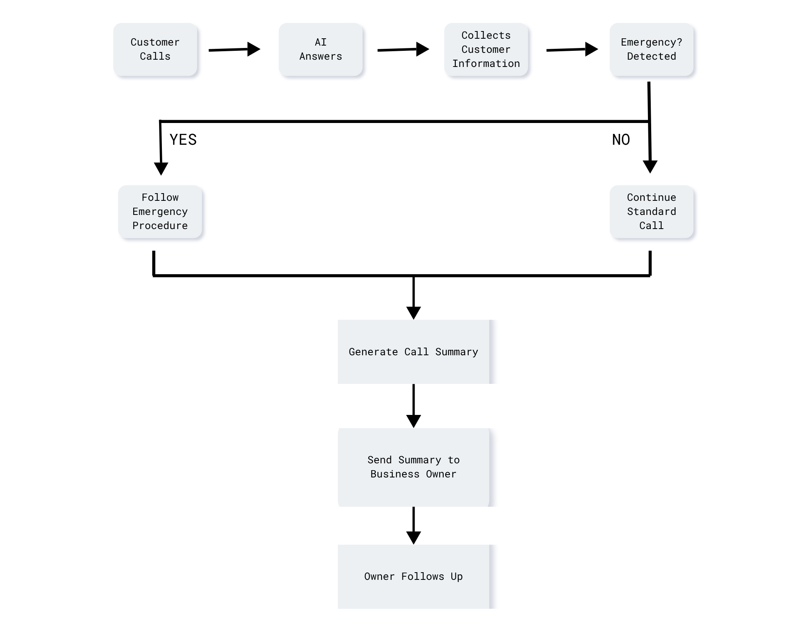
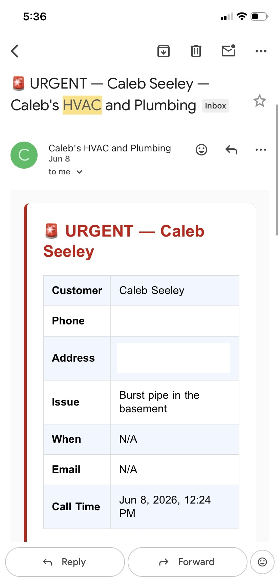
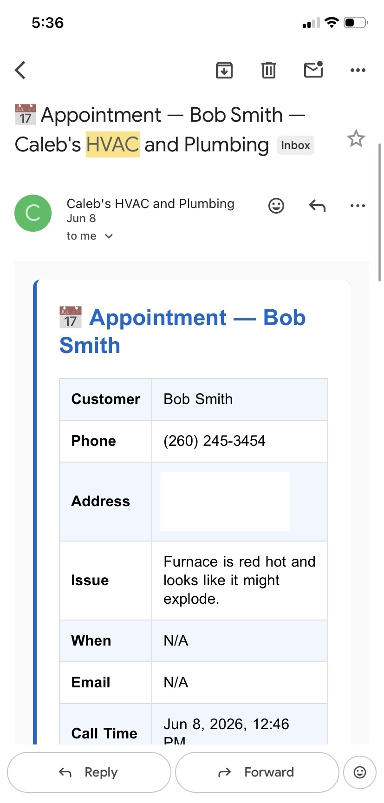
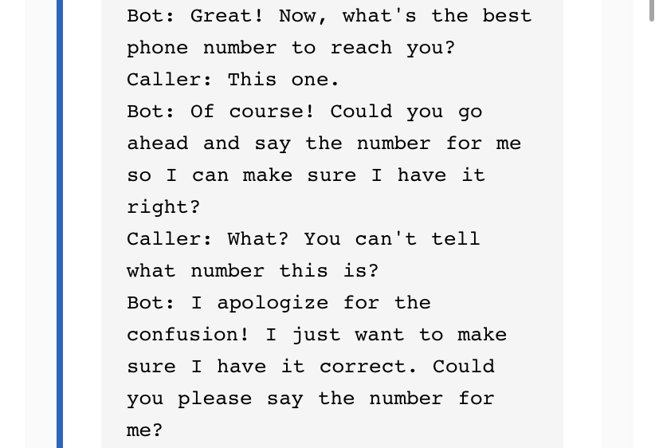

# Seely AI

## The Problem

Many HVAC and plumbing businesses depend on answering the phone quickly, even after normal business hours. Every unanswered call is a potential lost customer, but existing automated phone systems often leave customers frustrated instead of helping them.

## The Goal

This project explored whether AI could become a dependable first point of contact—one that could gather the right information, recognize urgent situations, and make it easier for business owners to follow up with confidence the next business day.

## The Approach

The system combined AI and voice technology to guide conversations, determine the customer’s needs, recognize urgent situations, and organize the information into a format business owners could quickly review and act on.

## System Overview



## Implementation Evidence

Aria was implemented as a connected workflow rather than only a conversational demo. Caleb designed and tested the call flow, conversation behavior, integrations, structured logging, summaries, and recovery behavior around realistic service-business scenarios.

The demonstrated workflow was:

```text
Incoming call
  -> consent message and consent handling
  -> speech transcription and AI conversation
  -> emergency or appointment-request path
  -> follow-up questions when information is incomplete
  -> structured business record
  -> owner summary for next-day action
```

The integration layer connected:

- Twilio for the inbound call flow;
- Deepgram for transcription after consent;
- OpenAI for dialogue handling;
- webhooks/API handoffs for moving information between workflow steps;
- Google Sheets for structured call records; and
- SendGrid for delivering summaries.

The repository includes safe-to-share artifacts that make the implementation inspectable without exposing credentials or customer information:

- [Call-flow diagram](seely-ai-flowchart.png) — the end-to-end workflow and handoff points.
- [Emergency call summary](seely-ai-emergency-summary.png) — the structured output for an urgent request.
- [Routine appointment summary](seely-ai-appointment-summary.png) — the output for a standard service request.
- [Conversation recovery example](seely-ai-conversation-recovery.png) — the system recovering after an unexpected or incomplete customer response.

The workflow was tested around consent behavior, emergency-versus-routine handling, incomplete answers, conversation recovery, structured output, and post-call delivery. These examples demonstrate implemented workflow behavior and troubleshooting judgment; they do not establish production uptime, customer adoption, call-volume scale, or commercial deployment.

### Example: Emergency Call Summary

This is the structured summary delivered to the business owner after an urgent service call.

<p align="center">
  
</p>

---

### Example: Routine Appointment Summary

This example shows how a routine appointment was organized into a clear, actionable follow-up.

<p align="center">
  
</p>

---

### Example: Conversation Recovery

This example shows the AI recovering naturally after an unexpected customer response instead of repeating scripted prompts or failing.

<p align="center">
  
</p>

## Demonstrated vs. Experimental

### Demonstrated in the project

- A consent-aware inbound voice workflow.
- AI conversation behavior for service-business calls.
- Emergency and standard appointment paths.
- Follow-up behavior for incomplete or unclear responses.
- Structured call records and business-owner summaries.
- Connected handoffs across telephony, transcription, AI dialogue, logging, and email delivery.
- Failure-mode testing and iterative workflow refinement.

### Not established by this public repository

- Production deployment at scale.
- Verified customer adoption, revenue, call volume, or long-term uptime.
- Accuracy or conversion metrics.
- A public automated regression-test suite.
- Commercialized operation after the project changed direction.

The public repository intentionally focuses on the workflow, implementation evidence, and representative outputs. Credentials, customer information, and proprietary operational materials are not included.

## Technology Stack

- OpenAI
- Deepgram
- Twilio
- SendGrid
- Google Sheets
- JavaScript / Node.js

## Project Outcomes

The project successfully demonstrated that an AI system could:

- Answer after-hours customer calls.
- Collect structured customer information.
- Distinguish between emergency and standard calls.
- Generate business-ready call summaries.
- Deliver those summaries for next-day follow-up.

Although the project ultimately changed direction before being commercialized, it became the foundation for several ideas that shaped later projects, including Leo and a new approach to product validation.

## What We Learned

The most valuable lesson from this project wasn’t technical.

While the system successfully demonstrated what AI could do, we realized we had approached the project in the wrong order. We invested significant time building a solution before confirming that customers truly wanted it.

That experience fundamentally changed how we approach new ideas. Instead of building first and searching for customers later, we now begin by validating the problem, confirming there is genuine demand, and only then investing in a solution.

That shift in thinking has influenced every major project that followed.
